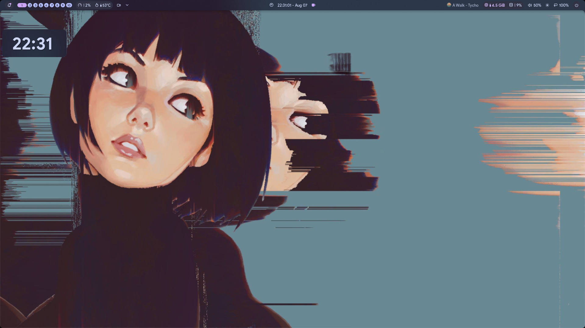
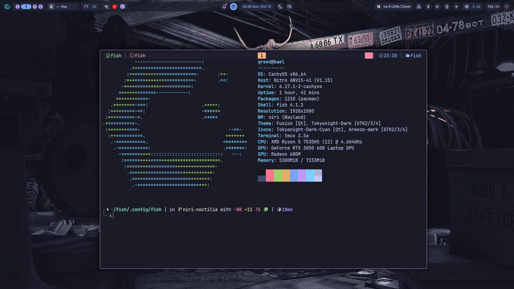
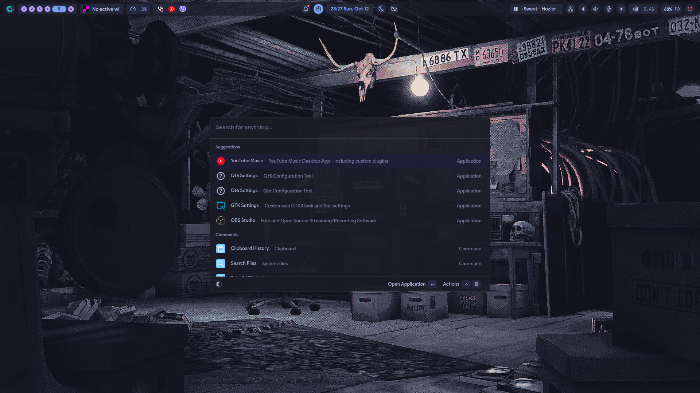

# Dotfiles

## A catppuccin rice

## Installation

The repository is managed with [GNU Stow](https://www.gnu.org/software/stow/).
A single cross-distribution installer is provided for Arch Linux and Fedora:

```bash
git clone <this-repository> ~/dotfiles
cd ~/dotfiles
./install.sh
```

Useful options:

```bash
./install.sh --dry-run       # show the plan without changing anything
./install.sh --stow-only     # only link the Stow packages
./install.sh --no-stow       # only install packages/fonts
./install.sh --skip-fonts    # skip user-local upstream font fallbacks
```

The installer checks the official repositories first, then Arch's AUR or
Fedora's COPR repositories, and only uses official upstream fallbacks when a
package is genuinely unavailable. Existing user files are never adopted or
overwritten: Stow is simulated first and conflicts abort the linking step.
See `progress.md` for the package-source notes and the remaining manual steps.

## Niri Branch for my dotfiles:

> [!NOTE]
> `wallpapers` moved to [wallpapers](https://www.github.com/greed-d/wallpapers) repository

> [!NOTE]
> Neovim config is in [nvim](https://github.com/greed-d/nvim) repo

> [!NOTE]
> Click on WM name for more screenshots and installation process


## [Screenshots](https://github.com/greed-d/.dotfiles/tree/niri-multi-theme/niri/.config/niri) <-- Click here for more screenshots

### Video Showcase:


### Wallpaper



### Fetch



### Launcher



## Star History

[](https://api.star-history.com/svg?repos=greed-d/.dotfiles&type=Date)
